# smart_attendance_app

A new Flutter project.

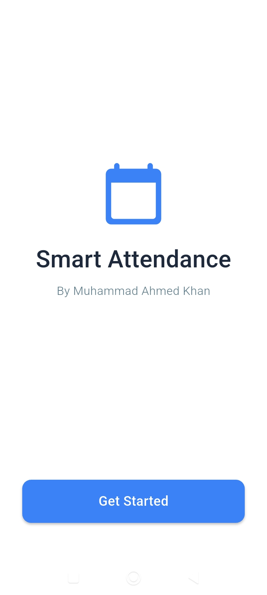
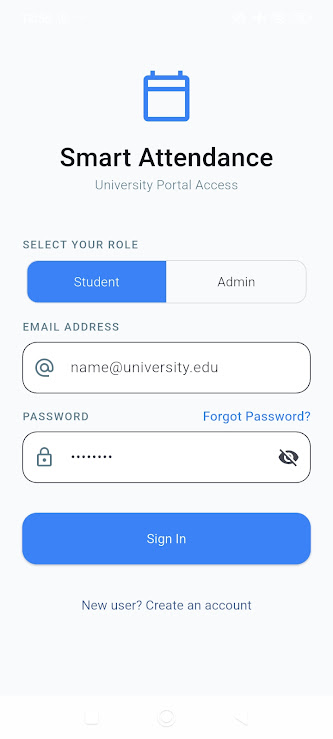
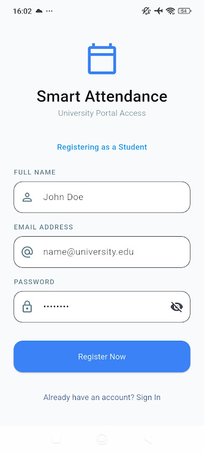
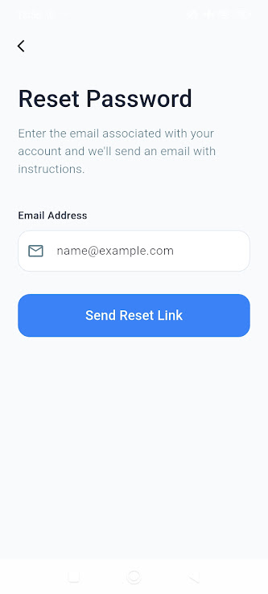
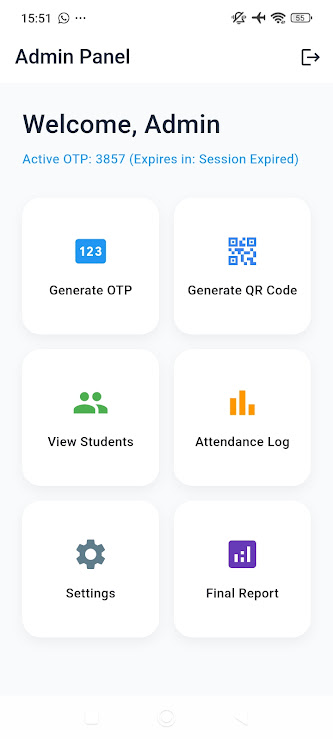
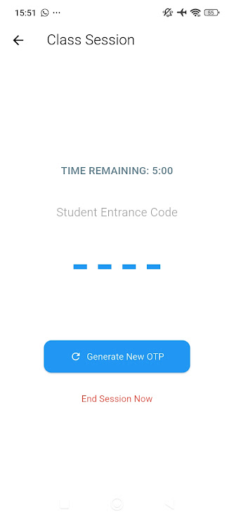
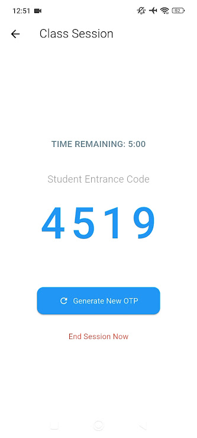
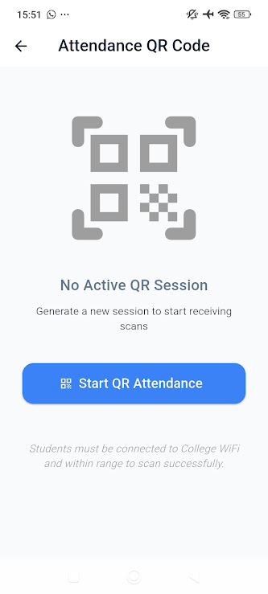
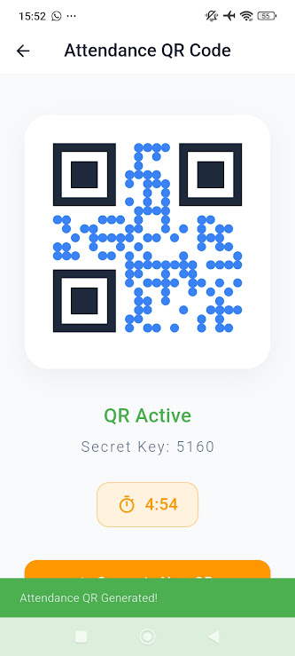
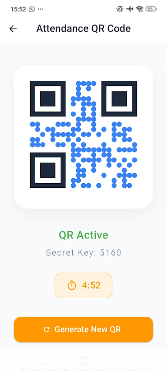
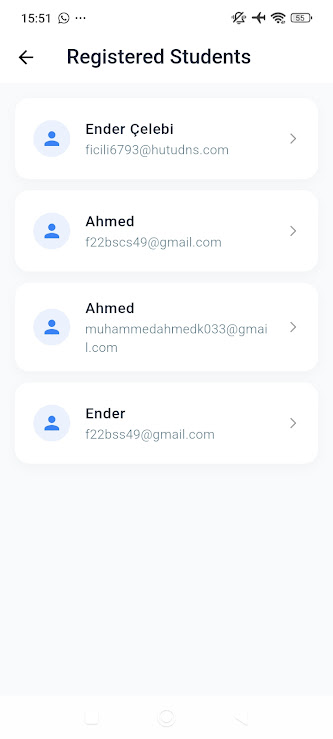
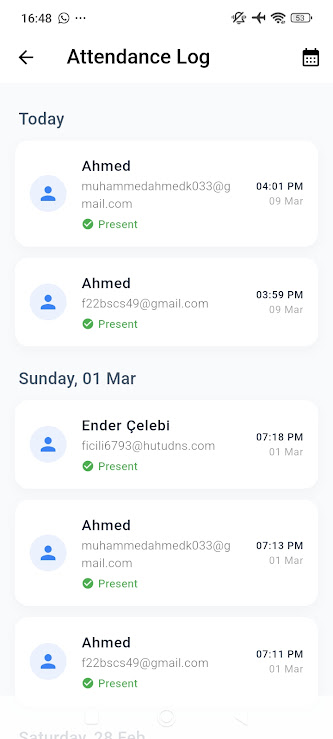
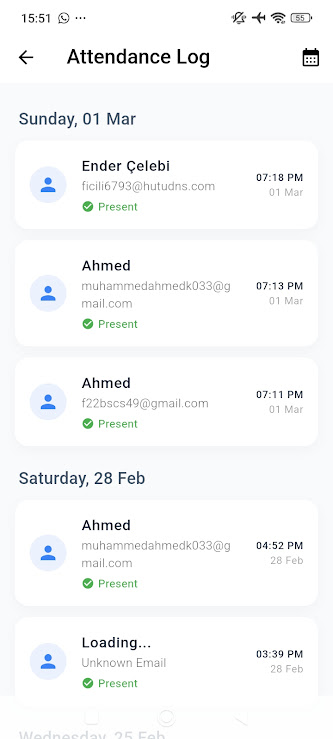
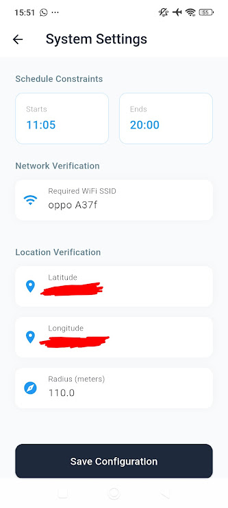
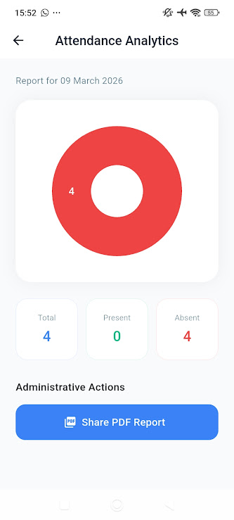
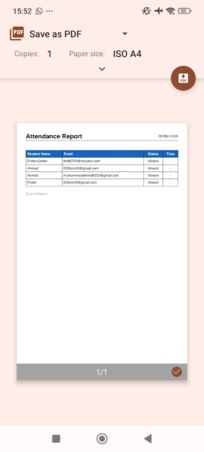
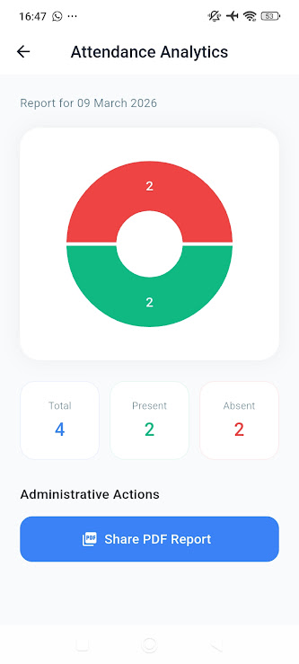
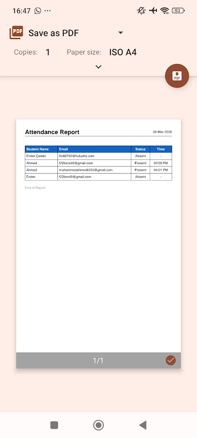
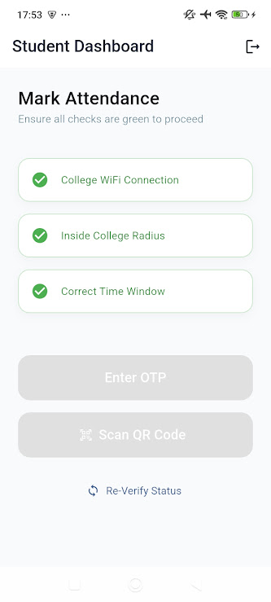
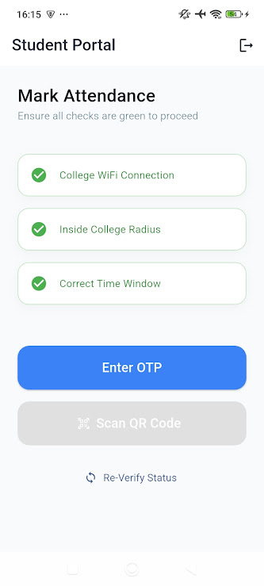
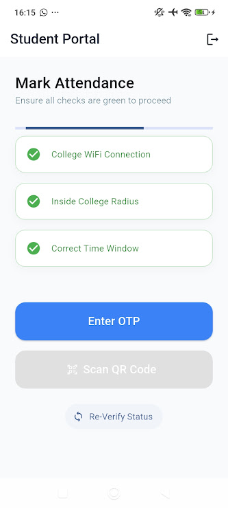
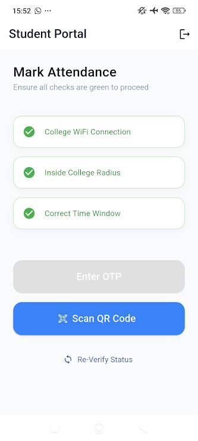
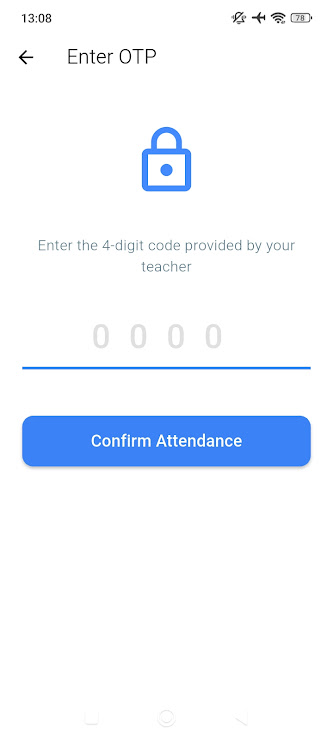
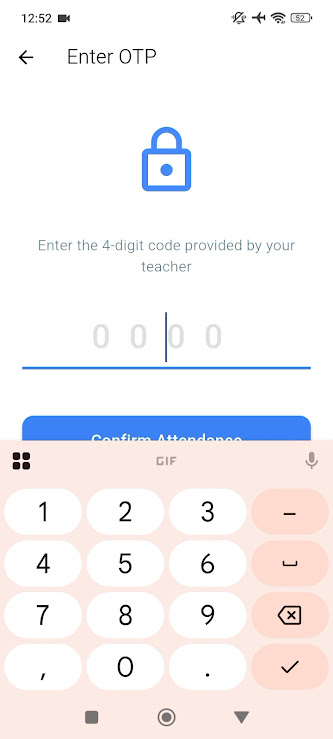
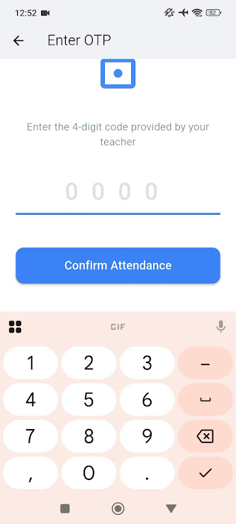
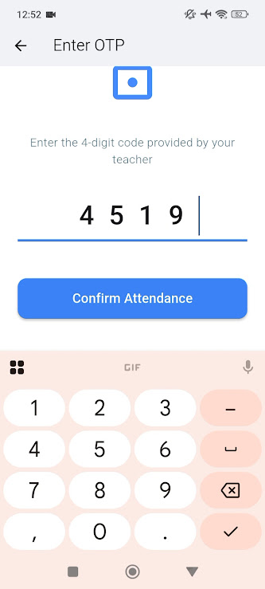
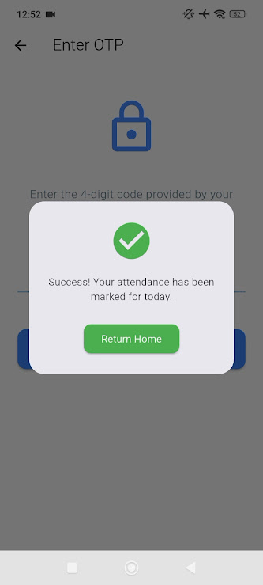

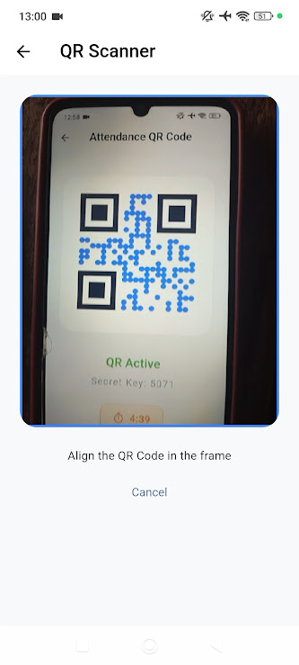
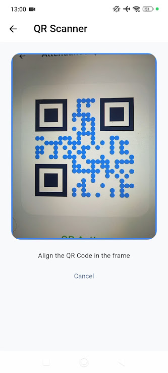
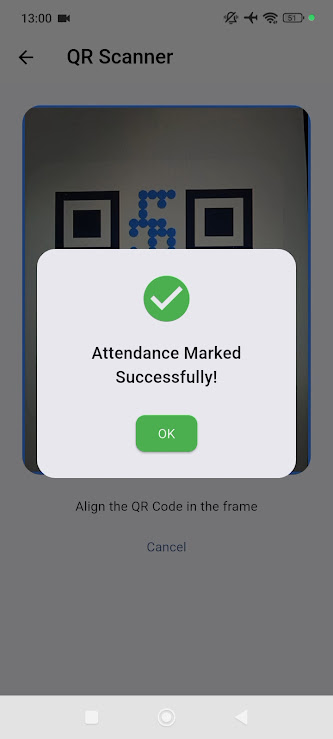

## Getting Started

The Smart Attendance App developed by Muhammad Ahmed Khan is a secure, cross-platform mobile solution built with Flutter and Firebase designed to automate and streamline academic attendance tracking. The application features dual-portal access equipped with role-based authentication (Student and Admin), secure password recovery, and strict validation protocols. To eliminate proxy attendance and ensure physical presence, the app enforces rigorous multi-factor checks—verifying that students are connected to the designated college Wi-Fi SSID, located within a precise GPS radius, and attempting check-ins strictly within scheduled college time windows. Device Binding is also done to ensure elimination of proxy attendance. QR Code Scan and OTP entrance features are  core features to address real world problems and eliminate proxy attendance.

Key Features

Dual-Role Authentication & Portal Access: Secure sign-up, login, and password reset functionalities via Firebase Auth, supporting distinct dashboards for Students and Admins.

Advanced Location & Network Security: Automated student validations that check current GPS coordinates against defined administrative latitude, longitude, and radius boundaries, alongside mandatory college Wi-Fi SSID verification.

Dynamic Session & Code Generation (Admin): Admins can generate time-sensitive 4-digit OTPs or active QR code attendance sessions with live countdown timers. 

QR Code: To make sure that the student is physically present inside the classroom.

OTP: To ensure smooth attendance when the students cannot physically walk to the admin to scan QR.

Instant Attendance Marking (Student): Students can check-in securely either by entering active OTP codes or utilizing an integrated in-app QR code scanner (mobile_scanner), backed by hardware-level device binding to prevent unauthorized proxy logins.

Real-Time Attendance Logs & Analytics: Comprehensive attendance monitoring logs that automatically track present and absent students dynamically by date, complete with visual breakdown charts (fl_chart).

Professional PDF Reporting: Admins can export, preview, and share official daily attendance reports compiled directly into formatted PDF documents.

Customizable System Settings: Dedicated configuration panels enabling administrators to adjust schedule constraints, required network SSIDs, location coordinates, and geofencing radiuses in real time.
